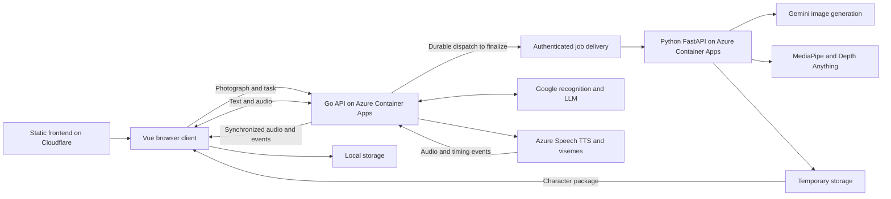

# Syntelle demo technical plan

Status: technical draft with Vue on Cloudflare and a Go API plus independent Python/FastAPI processor on Azure Container Apps, October 16, 2026. Agreed behavior is in [the specification](spec.md); comparisons and cost assumptions are in [providers and costs](research.md).

October 19 update: the owner selected PostgreSQL for preparation evidence. A local instance and content-addressed snapshot/request archive are implemented; see [preparation database](../../docs/preparation/preparation-database.md). Cloud database hosting, production job dispatch and visitor-data retention enforcement remain unimplemented. The development archive does not change the public validation endpoint's discard behavior.

Technologies described as candidates are proposals, not agreed choices. Host Vue separately on Cloudflare. Run Go for the main API and a separate Python/FastAPI image preparation service, both on Azure Container Apps with scale-to-zero. Express versus standard Consumption, supporting tools, inference runtime, persistence, and durable dispatch compatible with Azure remain open. Earlier Cloud Tasks, Firestore, and Cloud Storage proposals are not part of the current design.

The [first local build](../../docs/development/first-build.md) now implements Vue 3 with TypeScript, Vite, Pinia, and plain CSS; Go with `net/http`; and a separate Python/FastAPI/Pillow validator. Its Compose and browser checks are recorded there. This verifies image-file validation, not facial processing, conversation, or cloud deployment.

## Core decision

Prioritize Google for facial detection, variant generation, the LLM, and speech recognition. Azure Speech is selected for TTS and viseme events. Standard animation runs in the browser using previously prepared resources. The first prototype must show that automatic layers and transitions improve the previous example's naturalness.

Select the specific Azure Neural voice through a joint audio and viseme trial. MediaPipe provides image geometry and expression measurements; Syntelle owns the speech controller and the generation of its movements.

## Proposed architecture

| Part | Technology and status | Responsibility |
| --- | --- | --- |
| Web application | Vue 3 with TypeScript, Vite, and Composition API selected and used in the first local build. | Uploads, preliminary validation, progress, task configuration, conversation, local library, and private quota panel. |
| Web hosting | Cloudflare separate from the backend; Workers Static Assets on the free plan recommended. | Distribute the built application through the global network independently of Go container startup. |
| Shared interface state | Pinia included in the implementation plan. | Active character, preparation progress, configuration, and conversation state shared across components. |
| Renderer | Library open. Three.js is a candidate for the agreed parallax. | Parallax, geometry deformation, mouth, eyelids, and subtle motion. |
| Browser audio | Web Audio proposed. | Playback, synchronization clock, and immediate interruption. |
| TTS and visemes | Azure Speech selected; Go SDK integration awaits implementation and verification. | Synthesize speech and provide timed viseme identifiers. |
| Server | Go selected on Azure Container Apps with minimum zero. `net/http` implemented for local HTTP; WebSocket library open. | Anonymous sessions, providers, quotas, administrative authorization and settings, preparation coordination, and progressive conversation. |
| Image processing | Python/FastAPI selected for a separate Azure Container Apps service with minimum zero. Inference runtime awaits prototyping. | Server-side vision validation, alignment, masks, depth, and packaging without loading models into the conversation API. |
| Geometry | MediaPipe Face Landmarker, priority prototype candidate. | Face detection, landmarks, pose, and variant correspondences. |
| Depth | Depth Anything Small agreed as the starting point; version to verify. | Base map and additional depth variants only if beneficial. |
| Operational state | External durable persistence to select for scale-to-zero. | Jobs, reservations, consumption, and quota settings without visitor accounts. Administrative identity remains to be finalized. |
| Character storage | Local storage agreed; IndexedDB proposed. | Prepared files, manifest, task, and language in the same browser. |

Vue provides official Vite-based setup with optional TypeScript. Go provides net/http; package Go and FastAPI as separate containers. These supporting tools are implementation proposals; net/http alone is not assumed to support WebSockets without an additional library. [Vue quick start](https://vuejs.org/guide/quick-start.html), [net/http](https://pkg.go.dev/net/http). The diagram shows logical responsibilities in the selected architecture.

## Interface state with Pinia

The [installed development skills](../../docs/development/development-skills.md) guide Vue, the FastAPI processor, and visual review. Apply each within its scope while preserving MVP decisions and avoiding overengineering.

Use Pinia for shared interface state: active character and metadata, preparation progress, task and language, transient messages, and conversation state. Separate character, preparation, and conversation stores are proposed; keep component-only state within the component. [Pinia](https://pinia.vuejs.org/introduction.html).

Keep rendering, audio, and connection engines in services or composables with explicit lifecycles. Do not store per-frame updates, textures, audio buffers, or WebSocket objects as global reactive state. Pinia exposes summarized states such as preparing, listening, and speaking. Character persistence needs a separate local storage layer, with IndexedDB as a candidate; displayed quotas come from the API and are not authorized by Pinia.

## Selected Vue, Go, FastAPI, and Azure Container Apps deployment

The owner selected Azure Container Apps after reconsidering the architecture following the Azure Speech choice, replacing Cloud Run. Low cost, simple maintenance, and scale-to-zero remain priorities. Vue stays separately on Cloudflare, Go provides the main API, and FastAPI/Python provides the independent image processor. The [platform and usage-based compute comparison](deployment-options.md) preserves the analysis. Evaluate Express before fixing it for both services; supporting libraries and Azure-compatible persistence and dispatch remain open.

The Go API and FastAPI processor will be independently deployed and sized container applications on Azure Container Apps within the same repository. Both must scale to zero between uses. Vue has a separate static deployment on Cloudflare. No infrastructure has been contracted or configured.

## Static frontend on Cloudflare

Workers Static Assets on the free plan is recommended for the Vue build, with SPA route handling and no backend logic or API proxy in a Worker. Cloudflare recommends Workers for new projects; static requests are free and unlimited, and asset storage has no additional charge, subject to platform limits. Dynamic Worker code has different billing terms and is outside this proposal. [Platform recommendation](https://developers.cloudflare.com/pages/), [static asset pricing](https://developers.cloudflare.com/workers/static-assets/billing-and-limitations/), [Vue on Cloudflare](https://developers.cloudflare.com/workers/framework-guides/web-apps/vue/).

The browser fetches HTML, JavaScript, and CSS from Cloudflare and calls Go directly through HTTPS and WSS. Initial interface loading does not wait for API availability; backend operations display connection state. FastAPI requires Azure-compatible service authentication, with its mechanism still open, and is not called by the browser. Do not host private visitor images as public frontend assets on Cloudflare.

Configure the public API URL, an explicit HTTP origin allowlist, and WebSocket Origin validation. Anonymous cross-origin sessions must not depend on third-party cookies: evaluate same-site custom domains or a scoped session credential and verify mobile Safari. Provider credentials remain in Go or FastAPI. Budget a custom domain separately if selected; none has been purchased or chosen.

The owner has observed Container Apps Express cold starts under two seconds. This is a reference for the Azure prototype, not a Syntelle measurement. Measure lightweight API startup from zero separately from image model loading and first spoken response; do not treat two seconds as a platform guarantee.

Persist quotas and reservations durably outside temporary container storage. Run preparation during an active request or through durably triggered jobs rather than relying on work continuing after an HTTP response in a service that may stop. Estimate active compute and auxiliary services rather than a full month of always-on capacity.

## Vision models in FastAPI

Validate vision integration separately from the Go API. MediaPipe Face Landmarker provides a web API suitable for evaluating detection and alignment in a browser worker to avoid blocking the interface. This does not replace server validation before paid operations or justify trusting client coordinates. Perform that validation in FastAPI; the model and thresholds remain subject to prototyping. [MediaPipe Web](https://developers.google.com/edge/mediapipe/solutions/vision/face_landmarker/web_js).

Load Depth Anything Small in the FastAPI preparation service, outside the Go API process and container. Sharing a repository does not mean sharing CPU, memory, startup, or scaling.

The processor uses Python; select the runtime for compatibility and measured results. Start with a reproducible reference implementation and evaluate ONNX Runtime CPU if it improves duration, memory, or cost without degrading depth. A Go model binding is unnecessary. Measure CPU, memory, startup, and total duration with authorized images before fixing resource allocations or adding a GPU. [Reference implementation](https://github.com/DepthAnything/Depth-Anything-V2).

Compute the base map when creating or regenerating a character and save it with the resources. Conversation and browser parallax reuse the map rather than calling Depth Anything per turn or frame. This separates preparation waiting time from interactive latency.

FastAPI requires service authentication and rejects anonymous browser jobs. Go reserves quota and records a durable request. Azure-compatible queueing, authenticated delivery, and persistence remain open; they must return a job identifier to the browser without depending on a goroutine after the response. Retries reconcile that identifier to avoid duplicate paid generation. The browser queries Go for progress and downloads the package. FastAPI BackgroundTasks alone is not the durable preparation mechanism.

Processor startup is part of character preparation. The owner accepts up to ten minutes for the full process with visible progress; this does not assume one ten-minute HTTP request. First evaluate HTTP execution within the chosen ingress limits. If the full job does not fit, finalize durable stages or a compatible execution mechanism before deployment. Container Apps Jobs has not been selected. Both services use minimum zero and Consumption billing, measuring startup, connections, provider waits, and scale-down delay. Separation adds another deployment and temporary persistence; it does not inherently guarantee lower total cost. [Container Apps billing](https://learn.microsoft.com/en-us/azure/container-apps/billing).

## Proposed processor optimization

There are no measurements or optimized implementation yet. Validate these initial technical choices in the prototype:

- Load one model copy per instance through FastAPI lifespan and reuse it while the instance remains available. Bundle versioned weights to avoid downloading them for every request; startup from zero still requires initialization. [Lifespan](https://fastapi.tiangolo.com/advanced/events/).
- Start with one Uvicorn process per container and one concurrent heavy request per replica. Limit admitted work and queue dispatch as well as replica count; a scaling threshold is not processor concurrency control. Tune after measurement, and do not treat maximum replicas as a spending limit. [FastAPI server processes](https://fastapi.tiangolo.com/deployment/server-workers/).
- Run blocking inference outside the async event loop and limit runtime threads to allocated resources to prevent nested parallelism overload. async does not make CPU inference lightweight. [FastAPI concurrency](https://fastapi.tiangolo.com/async/).
- Start with CPU, inference dependencies without unnecessary GPU components, and bounded input resolution. Disable gradient computation where applicable. Evaluate GPU only if measurements justify its cost.
- Compare the reproducible reference with ONNX Runtime CPU. Evaluate quantization only after verifying compatibility and map quality; changing formats does not imply an improvement.
- Generate the base map once per preparation and reuse it. Scope any cache to the anonymous identity and identical image, model, and parameter versions without exposing other visitors' resources.
- Measure startup from zero, model loading, inference duration, peak memory, cost, and parallax quality separately. Adjust Azure resources and input resolution from those results.

Optimization does not mean promising model cold starts under two seconds. Evaluate that startup reference in Go; preparation includes FastAPI startup and inference.

## Automatic character preparation

On entry, offer a preprocessed sample character using owned or authorized resources alongside photograph upload. The sample uses the same manifest format and engine as custom characters, with a versioned public package among Cloudflare's static assets. Loading it performs no per-visitor image generation or inference. Conversation still goes through Go and consumes the same personal speech and listening quotas. Only custom preparation reserves and consumes creation quota; switching characters does not reset counters. The sample is not subject to visitor temporary file cleanup.

1. Open an anonymous session and query quotas. The browser checks whether it can decode the photograph.
2. Validate face count, orientation, resolution, and visibility on the server before paid image requests.
3. Atomically reserve quota and budget and create an idempotent job. Reloading must not launch a second batch.
4. Generate each variant from the same base photograph and supplied prompts. Record model, prompt version, parameters, tokens, and estimated cost.
5. Measure the base and variants with MediaPipe. Align stable features and reject incompatible identity, pose, or lighting changes.
6. Create mouth and eye masks with face-adapted margins, opaque interiors, and soft edges. Preserve the base outside those regions.
7. Compute the base depth map. Test per-pose maps only after measuring a shared base map and verifying scale consistency.
8. Create mesh correspondences and test pose transitions. Keep the variants needed for teeth, mouth interiors, and eyelids; geometry does not invent these textures.
9. Export optimized resources and a versioned manifest. Compose layers over the base and validate mouth and blink combinations.
10. Download and save the package in the chosen local storage, confirm local availability, and clean temporary files according to retention policy.

Job states: received, validating, generating, preparing, checking, ready, and failed. Each provides understandable progress and recoverable errors. Commit the creation reservation exactly once when the character is ready to use; release it on failed preparation. Provider costs already incurred remain in the global counter. Default to one automatic retry for transient failures within the global budget; reuse completed stages and never automatically retry rejected photographs. Report final failure clearly and permit another visitor-initiated attempt subject to quotas and budget.

Once the server accepts the upload and creates the job, execution is independent of the browser connection. Store a scoped job reference locally and durable progress on the server, associated with the anonymous visitor identity. Closing the tab does not cancel work. On return in the same browser, restore progress or download the completed package while its resources remain available. Do not create a replacement job, repeat completed paid work, or consume creation quota again. Recovery does not extend the 24-hour retention policy; explain expired results or lost browser identity and offer the sample or a new creation subject to quota.

The manifest includes normalized dimensions and orientation, viseme groups, layers, masks, coordinates, geometry correspondences, depth, and format version. Compact resources retain their placement within the canvas. Include neither credentials nor other visitors' data.

## Conversation and speech generation

Visitors choose English or Spanish and define a task. A generic prompt supports testing while company information is pending. Limit LLM response size and send useful chunks so speech can begin before a long response completes.

Azure Speech is selected for MVP TTS. Go requests Neural voices and receives audio and viseme identifiers with AudioOffset through the SDK. Select a compatible voice per language using English and Spanish test phrases. The base path requires neither Rhubarb extraction nor a self-hosted voice model. Quality, latency, and continuity still need measurement. [Azure Speech visemes](https://learn.microsoft.com/en-us/azure/ai-services/speech-service/how-to-speech-synthesis-viseme).

Go runs on Azure Container Apps and consumes Azure Speech as a separate managed service. Configure credentials and region only on the server; do not give the browser keys or uncontrolled access to paid synthesis. Pin the Go SDK's native Linux dependencies and verify container builds, startup, memory, resource cleanup, and cancellation. Neither FastAPI nor Depth Anything is invoked for each spoken response. Selecting Azure synthesis and hosting does not determine recognition. [Go SDK](https://pkg.go.dev/github.com/Microsoft/cognitive-services-speech-sdk-go/speech).

Map visemes to the manifest's mouth groups; generating one image per Azure identifier is unnecessary. Normalize offsets to segment time and play them against the browser's real audio clock rather than network event arrival. Our engine remains responsible for smooth transitions and natural movement.

Normalize providers into audio segments and timing events containing turn ID, segment ID, start, duration, mouth shape, and weight. Adapt articulation to context and duration to avoid jumps and preserve readable closures. Do not replace phonemes with random movement to simulate activity.

Use actual audio playback position with calibrated visual compensation to determine mouth state. Investigate device output timing through [Web Audio](https://developer.mozilla.org/en-US/docs/Web/API/AudioContext/getOutputTimestamp). Network arrivals and independent timers are not the animation clock.

## Open conversation and interruptions

- Request echo cancellation and noise reduction when supported. Verify with speakers as well as headphones.
- Local speech onset detection immediately stops character playback and sends turn cancellation to the server. Distinguish visitor speech from played audio to prevent false interruptions.
- The server cancels or stops requesting text and speech for the previous turn. Already billed calls are not assumed refundable.
- Give each turn an identifiable generation. Discard late segments and their visual queue from canceled generations.
- Preserve conversation context when the visitor speaks again without replaying the canceled response. Distinguish generated text from content actually delivered.
- Progressive recognition handles partial and final results, silence, and reconnection without duplicate messages.

Cloud STT V2 streams have a documented five-minute limit. Renew the connection before reaching it and avoid gaps or duplicates if the session continues. [Cloud STT quotas](https://docs.cloud.google.com/speech-to-text/docs/quotas).

## Local storage and temporary files

The selected local storage saves the prepared character and configuration with a schema version and deletion option. IndexedDB is proposed, not confirmed. Verify package completeness before marking it reusable. Explain unavailable or deleted storage and apply server quotas.

Conversation messages and microphone audio remain transient during the session. Automatically delete photographs and temporary resources from our server after 24 hours, measured from each file's creation, including failed or abandoned jobs. Keep downloaded characters in the browser. Temporary cleanup does not reset quotas or delete operational settings. Explain transmission to Gemini before upload; this retention policy describes our storage and does not replace provider terms.

## Limits and spending control

The owner confirmed one character per visitor every 24 hours and configurable speech and listening quotas. Initial defaults are 180 seconds of character speech and 360 seconds of processed listening audio. Consume creation quota only when the character is ready; failed preparation releases its reservation, and querying or resuming a job does not duplicate consumption. Speech and listening counters are independent; leaving the page open without sending recognition audio consumes no listening quota.

An owner-only private panel manages these durations without code changes or redeployment. It is part of Vue and calls administrative Go operations protected by server-side authentication and owner authorization. The authentication method remains open; the MVP includes neither additional administrators nor visitor accounts.

Go validates settings and saves a version to external durable persistence. Instances must consult or refresh cached configuration to apply updates without redeployment rather than keeping settings only in memory or deployment variables. As a simple implementation default, subsequent operations use saved quota values, including active windows, without resetting durable consumption counters. If a new limit is already exhausted, the normal exhaustion rule applies at the next quota check. The public API exposes only effective limits and the visitor's consumption; Pinia displays them without authorizing changes. The initial panel manages only speech and listening quotas.

Use a rolling 24-hour window from first counted consumption as the implementation default. To keep the implementation simple as requested, the server counts generated audio duration. Interruptions cancel pending generation without reversing generated consumption. Incurred costs remain in the global counter. Explain this rule in the interface; it does not require measuring how much audio the visitor heard.

Exhausting the configured character speech quota ends all conversation, including text, until renewal. Browser and server reject new turns and cancel active synthesis and recognition. The character and configuration remain local; reloading does not restore quota. If listening is exhausted first, disable the microphone, close recognition, and reject further audio while accepting text as long as speech quota remains. Spoken, animated responses consume that remaining quota.

Anonymous identity uses a random identifier and signed cookie. The server applies per-visitor reservations, an additional IP request limit, and a global limit. Clearing browser data may change approximate identity; the global reservation bounds spending even then.

Paid operations reserve a maximum amount before calling providers and reconcile actual usage afterward. Include simultaneous requests, retries, and operations already in progress in reservations. Bound prompt length, LLM context, and output. Reserve listening in time blocks and close the stream when quota ends.

Configure an explicit global budget. Missing configuration or exhausted budget suspends new paid operations with a clear message. Billing alerts supplement this control rather than replacing it.

## Proposed trial targets

These are initial measurement criteria, not achieved results. Validate them under the load and network conditions recorded in the trial report.

| Area | Initial target |
| --- | --- |
| Input | One frontal face without significant occlusion; accept JPG/JPEG, PNG, and WebP up to the agreed 5 MB per image. Enforce size on the client and server and calibrate visual and resolution thresholds with examples. |
| Test set | At least ten owned or authorized photographs with varied lighting, skin tones, and features, plus incompatible cases. |
| Preparation | Agreed acceptable initial wait of up to ten minutes with visible progress. Record median and 95th percentile under documented load; no measurements yet. |
| First spoken response | Provisionally accepted target of audible speech starting within about three seconds after the visitor finishes speaking, including receiving and preparing Azure Speech viseme events. Validate in the prototype and record median and 95th percentile; no percentile threshold is confirmed. |
| Interruption | 95th percentile of up to 250 ms from locally detected speech onset to stopping character output. |
| Synchronization | Up to 100 ms offset at annotated test phrase points; measure lip closures and continuity. |
| Rendering | At least 30 frames per second on test devices, reducing resolution and quality if needed. |
| Visual quality | No double mouth, halos, framing jumps, or breathing-induced facial deformation. Compare transitions with the same authorized resources. |

iPhone Safari is a confirmed launch requirement. Verify the full sample and custom character journeys on a real iPhone, including microphone permission handling, audio activation, local storage, and interruptions. The proposed wider test matrix includes desktop Chrome, Edge, Firefox, and Safari, plus Android Chrome; record exact device and browser versions. Test denied permissions, the initial gesture required to activate audio, orientation changes, and audio suspension when switching applications. Preserve conversation and articulation in 2D mode if depth rendering is unavailable.

## Implementation order

1. Finalize Vue and Go tools, model integration, the Azure Container Apps mode, and compatible supporting services.
2. Prototype extraction and animation with authorized material to resolve identity, crops, and transitions.
3. Integrate Azure Speech and verify voices, audio, and visemes with the Go SDK, including cancellation and Azure Container Apps startup.
4. Complete the photograph-to-locally-saved-character flow.
5. Add text conversation with speech and synchronization.
6. Add open microphone, interruptions, and reconnection.
7. Add durable quotas, private panel, global reservations, and concurrency and failure trials.
8. Verify desktop and mobile and measure end-to-end cost.

Executable detail is in [the tasks](tasks.md). Finalize models, input limits, and targets using prototype measurements while preserving product priorities.
